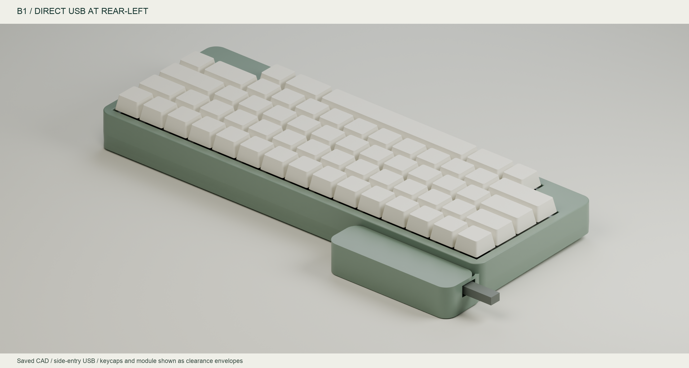
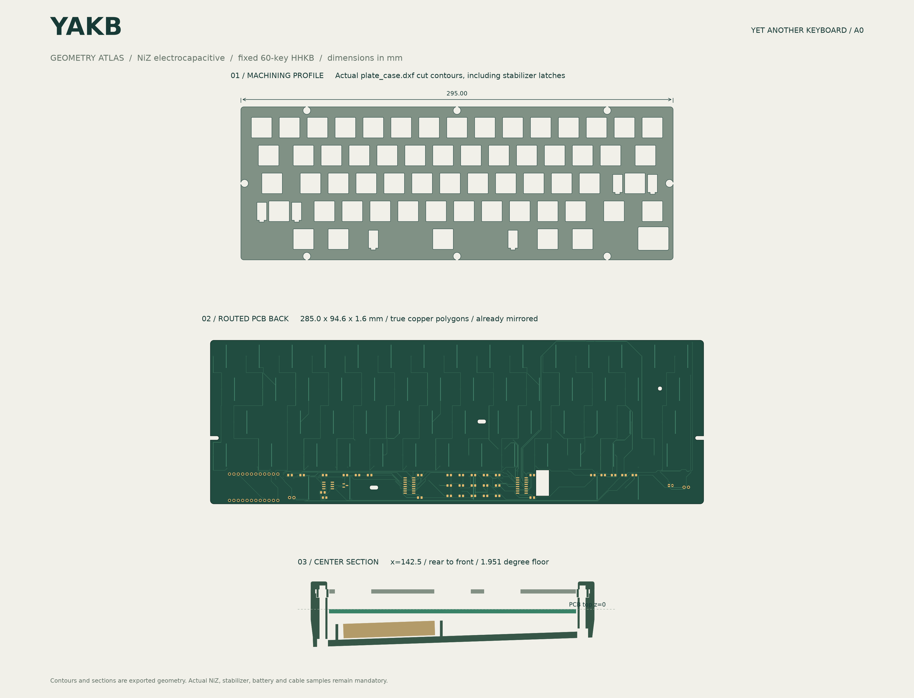

# YAKB — Yet Another KeyBoard

> **Current variant: B1 modular controller.** The rear-left carrier accepts USB directly from the left side; the original U1 position takes a passive interposer. Start with the [B1 PCB, FPC, case and qualification notes](docs/modular/README.md) and [B1 soldering workbench](hardware/soldering/b1/index.html). A0 drawings below remain the baseline reference.

[A0 reference soldering workbench](hardware/soldering/index.html): 18 illustrated steps, searchable references, saved progress, zoom and print.

[简体中文](README.zh-CN.md) · [Design](docs/design.md) · [Soldering order](docs/soldering-guide.md) · [Compatibility](docs/compatibility.md)

A NiZ electrocapacitive keyboard with a fixed 60-key HHKB layout, centered-stem 6u spacebar, BLE / USB, and a rechargeable battery. The design uses a socketable **nice!nano v2 / nRF52840**, a ZMK EC module, SOIC analog ICs, and hand-solder 0805 passives.

**A0 engineering prototype.** See [reports](reports/) for the actual checks. No PCB has been fabricated, no physical NiZ/stabilizer/case fit has been confirmed, and runtime has not been measured. File checks do not certify hardware operation. Validate the fit coupon and a small EC matrix before committing to complete plates or assembled boards.

| Item | A0 selection |
| --- | --- |
| Layout | 60 keys, HHKB Control position, split right Shift + Fn, asymmetric bottom row, centered-stem 6u space |
| Mechanism | NiZ housings, MX-cross sliders and silencing rings, separate domes and sensing conical springs |
| PCB | 285.0 × 94.6 × 1.6 mm, four copper layers, Lot60 / GH60 reference mounting clearances |
| Plate | 1.6 mm; initial 14.0 mm R0.5 cutouts; 13.9 / 14.0 / 14.1 mm fit coupon supplied |
| Controller | Socketable nice!nano v2 using 2.54 mm through holes; RF, clocks, MCU and charger already assembled |
| Analog | Two CD74HC4051M96, one OPA350UA, one AO3401A; 0805 hand-solder passives |
| Cell | Protected 1S LiPo; 1000 mAh calculation basis; complete cell/PCM/lead envelope ≤60 × 35 × 5.5 mm |
| USB | B1 connects directly to its rear-left carrier; the A0 extension arrangement is retained as historical reference |
| Printed case | Original 299 × 108.6 mm coved wedge case, HHKB bezel, STEP/STL and assembly STEP |
| Case reuse | GH60/Poker tray family is a compatibility target; PH60 HHKB 6u is a reuse candidate requiring adaptation |

Start with [schematic](hardware/YAKB.kicad_sch), [PCB](hardware/YAKB.kicad_pcb), [BOM](hardware/BOM.csv), [dimension source](design/yakb.json), [pin map](design/pin-map.csv), and [key coordinates](design/key-map.csv).

Mechanical outputs include [assembly STEP](mechanical/assembly.step), [base STL](mechanical/case_base.stl), [bezel STL](mechanical/case_bezel.stl), [fit coupon](mechanical/niz_fit_coupon.stl), [case plate DXF](mechanical/plate_case.dxf), and [tray-envelope plate DXF](mechanical/plate_tray.dxf). DXF units are mm; do not cut the `REFERENCE` layer.

**Case compatibility is conditional.** PCB outline and mounting similarities do not establish battery clearance, USB alignment, plate retention or RF performance. Metal cases need an antenna window. A tray-envelope plate alone does not form a validated drop-in assembly. See the compatibility document before buying a case.

There are 60 sensing cells and 40 populated modules/components/harness positions, excluding parts already assembled on the controller. No per-key diodes, hot-swap sockets, RGB, display, or separate USB controller are used.

[Reproduction](docs/reproduce.md) · [Firmware](firmware/) · [Sources and pinned revisions](docs/sources.md). Original YAKB files use MIT; reused Tako footprints retain their MIT notice.

Native checks: **0 ERC violations, 0 DRC violations, 0 airwires, 0 schematic parity differences**. The normal and calibration firmware builds succeeded. [Fabrication files](fabrication/) · [case redesign](docs/case-design.md) · [KiCad library license](licenses/KiCad-library-notice.md).

[Review and fixes](docs/review-fixes.md) · [Electrical, RF and power budget](docs/electrical-analysis.md)

The case now fastens from below with no visible top screw holes. Drawings use the current PCB/STEP/DXF. USB and BLE are compiled in; Fn+5 / Fn+6 selects output.

[Battery options and actual three-bay case](docs/battery-options.md).

[Inventory review and purchasing](docs/inventory-review.md).

[Case orientation and USB assembly status](docs/assembly-interface.md).
