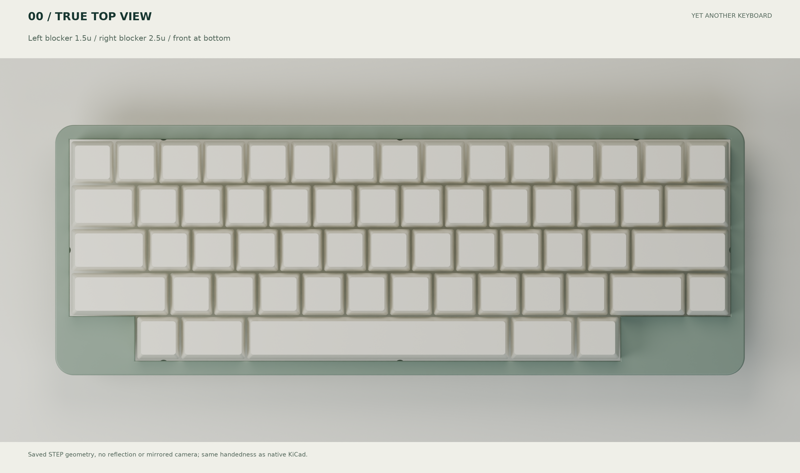

# Case orientation and USB connection status

> **B1.1 update:** This document describes the A0 baseline. Use the [B1 notes](modular/README.md) for the separate controller, direct USB, new base, FPC and assembly differences. Do not populate the A0 U1 MCU in B1.

[简体中文](assembly-interface.zh-CN.md)

The bottom row starts at 1.5u and ends at 12.5u in a 15u layout, giving a 1.5u left blocker and 2.5u right blocker around a centered-stem 6u spacebar.

The old renderer reflected Y while delivered STEP/STL used a different orientation. Orienting the native model with its front toward the viewer could therefore disagree with the render. This was an export-coordinate defect, not a perspective effect.

Delivered STEP/STL/DXF now use **X right, Y rear, Z above the PCB**. Looking down from +Z, +Y is screen-up and the spacebar is at -Y. Design JSON and construction reports retain KiCad screen coordinates; export applies CAD Y=-construction y exactly once. Rendering does not reflect geometry. Printable base STL additionally rotates the floor onto the build plane.

`verify_mechanical_frame.py` probes the actual asymmetric bezel solid and board/module envelopes. Construction dimensions for the blocker solids are 28.4 mm left and 47.7 mm right, with keycap clearance.

The current nice!nano is underneath the PCB near the front-right (construction center approximately 258.73,85mm), with USB pointing left. The case opening is at the rear-left, approximately X18.65 mm/CAD Y+7mm. **The opening does not directly align with the module connector.**

The intended chain was external data cable → rear USB-C receptacle → internal extension → module USB-C plug. Only the case opening and a local plug envelope were delivered; the complete purchased extension, continuous cable corridor and receptacle retention were not. Local plug clearance does not establish a working closed-case assembly.

Until the interface revision is completed, connect directly to the module for bare-board debugging and treat closed-case USB as **mechanically unvalidated; do not fabricate a finished case on that assumption**. Retaining the module requires a qualified extension and mounting/cable checks. Direct rear access requires moving the controller, rerouting the PCB and rechecking electrodes, insertion clearance and RF keepouts.

Connection topology (not an approved cable route):

