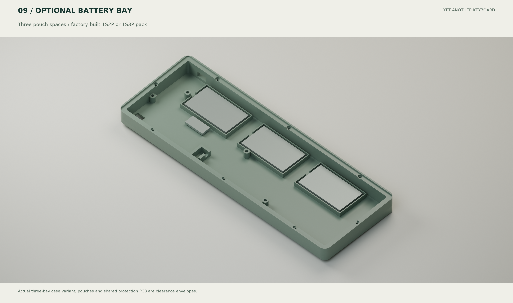

# 多电池空间研究

> **版本范围：A0 基础设计 / 历史记录。** 当前整机为 B1.1；独立主控、直接 USB、专用底壳与 FPC 以 [B1.1 说明](modular/README.zh-CN.md) 和[文件版本表](file-map.zh-CN.md)为准。主板 U1 不装主控。

[English](battery-options.md) · [CAD 检查数据](../reports/battery-study.json) · [功耗模型](electrical-analysis.zh-CN.md)

**空间可以支持三个薄电芯位置。** 已在当前底壳、PCB、37个原生器件模型、主控、USB和隐藏螺丝模型上检查三组60×35×5.5 mm包络，均无相交。以下为构造坐标（交付 CAD 的 Y 取负）：中心坐标为 `(62,23,-7.8)`、`(144,23,-7.8)`、`(226,23,-7.8)`，沿底面倾斜。每块至底壳的最小间距约0.526 mm、至PCB约2.856 mm；隔离胶带/固定材料必须计入净空，不能挤压电芯。

B1.1 使用[专用三仓底壳](../mechanical/modular/case_base_B1_three_bay.stl)和[后舱盖](../mechanical/modular/pod_lid_B1.stl)，上框和定位板共用 A0。以下 12.8/25.5/38.3 天为 A0 的混合使用情景，不是 B1.1 实测续航；B1.1 另计 FPC/ADC 电容负载的连续活动估算见[模块化功耗分析](modular/README.zh-CN.md)。

提供可选 [三仓底壳 STEP](../mechanical/case_base_three_bay.step) / [STL](../mechanical/case_base_three_bay.stl)，复用相同PCB、上框、定位板及底部螺丝。单仓底壳仍保留。三仓版只增加两处电池围栏，可安装两芯包并空置一仓，或安装三芯包。共享保护板预留25×12×3 mm空间，位于x=49.5…74.5、y=46…58、z=-8.5…-5.5。线缆和实际保护板需按供应商图纸核对。

| 方案 | 目标容量（每芯1000mAh假设） | 中间使用情景续航 | 100mA理想充电下限 |
| --- | --- | --- | --- |
| 单芯1S | 1000mAh | 约12.8天 | 10小时 |
| 厂家配组1S2P | 2000mAh | 约25.5天 | 20小时 |
| 厂家配组1S3P | 3000mAh | 约38.3天 | 30小时 |

推荐两芯作为续航与重量的折中，三芯作为可选容量上限方案；这里的“上限”指已设计的三个仓位，不代表穷尽所有空间。容量按目标估算，没有指定并验证某个1000mAh电芯。必须用包括封边、铝塑膜、出线和绝缘的完整最大尺寸核对，不能仅依据“503450”一类代号购买。

电路仍只接受 **1S，3.7V名义/4.2V满充**。采用由电池厂家完成配组、焊接、绝缘和保护的一体式1S2P/1S3P包，单一输出接原J1；要求配套保护与适当的支路故障保护。PCB不增加让用户直接并联独立电池的插口，不串联成2S/3S，也不混接新旧或不同型号电池。并联提高容量而不提高电压，但电压不匹配会产生均衡电流。[SparkFun 电池连接说明](https://learn.sparkfun.com/tutorials/what-is-a-battery/usage)

保持默认100mA充电，实际时间会超过表中下限。新增电芯的金属膜位于感应区下方，可能改变寄生电容；安装最终电池包后重新校准并做蓝牙、误触和充电温升测试。这些CAD结果不代表电芯已采购或实测认证。
