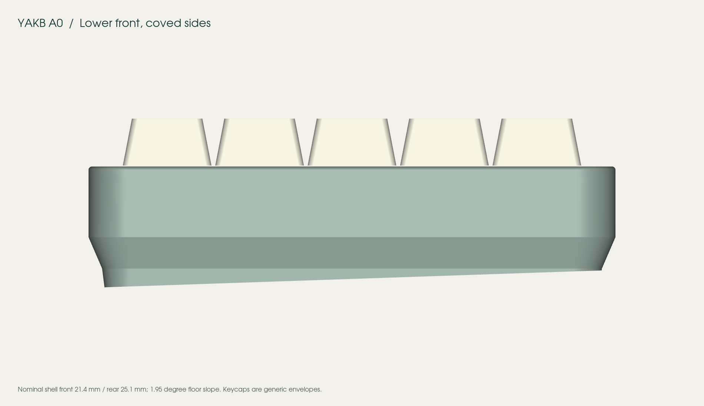

# Revised case: a lower front and softer side profile

[简体中文](case-design.zh-CN.md) · [Compatibility](compatibility.md)

The first case was a straight-sided, 25.1 mm constant-height box. The actual CAD now uses **R8 corners, a recessed lower skirt and a shallow wedge floor**.

| Item | First design | Current design |
| --- | --- | --- |
| Plan envelope | 301×110.6 mm | 299×108.6 mm |
| Nominal shell front height, no feet/caps | 25.1 mm | 21.4 mm, 3.7 mm / about 15% lower |
| Nominal rear height | 25.1 mm | 25.1 mm |
| Floor | Flat | 1.95° slope |
| Plan corners | R5 | R8 |
| Lower skirt | Straight | Approximately 3.5 mm inset with sloping transitions |
| Bezel edge | Sharp | 0.7 mm round-over |
| Cell | Horizontal deep cavity | Parallel to the sloping inside floor |
| Plate edge | Exposed layer gap | Stepped pocket with 0.3 mm edge clearance |

The nominal heights use the top surface and extended floor plane in the shared PCB-top z=0 frame. Rounded corners and the skirt remove lower-edge material. Floor thickness is 2.4 mm; outside floor z=-10.8 at front and -14.5 at rear. The front-right socketable controller still needs roughly 0.5 mm model clearance. Further reduction requires changing controller/socket packaging or internal layout.

The complete protected cell remains ≤60×35×5.5 mm. It is tilted as a rigid pack with the floor, never bent. Its transformed bounding box is approximately x=114…174, y=5.417…40.584, z=-11.144…-4.456. Match retention thickness to the actual pack without compressing it.

References:

- [Bakeneko 60 V3](https://github.com/kkatano/bakeneko-60): low front and side proportions; upstream specifies 18.5 mm front, 6° and 295×110×30 mm. Its packaging differs; this design does not claim its O-ring mount.
- [PH60](https://github.com/ph-design/PH60): printable case, separate battery packaging and removable cover. Local HHKB 6u STEP inspected; no upstream mesh or magnetic mechanism copied. PH60's split construction addresses smaller print beds; the current YAKB base remains one piece.
- [HSKB](https://github.com/hungrygeek/HSKB) and original Dev01-D source: true 6u HHKB bottom row and blocker proportions. An MX integrated plate cannot replace the NiZ 1.6 mm plate directly.
- [ECneko60](https://github.com/mattyintegrals/ecneko60): a real NiZ/EC60 build in the open Bakeneko case, including necessary modifications. It is evidence of an adaptation path rather than universal compatibility.

The YAKB case is independently generated; see [source/license boundaries](sources.md). STEP files retain assembly coordinates. `case_base.stl` is deliberately rotated with its bottom flat on z=0 for slicing and therefore differs from the assembly frame. The one-piece base needs a 320 mm-class bed or print service. Print insert, switch and stabilizer coupons first. Selected clearances and intersections are in `reports/mechanical.json`; actual cables, fasteners and switches remain first-article checks.
