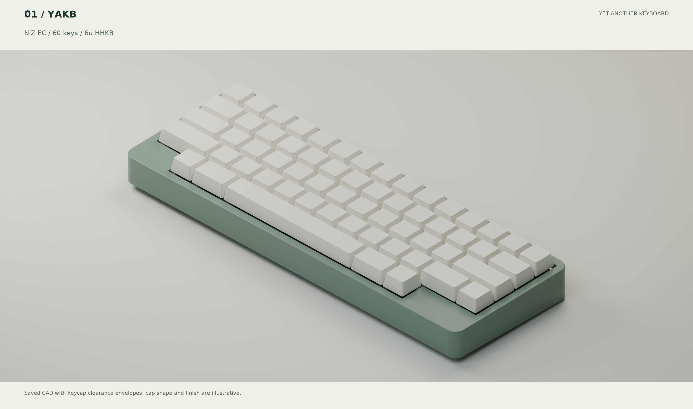
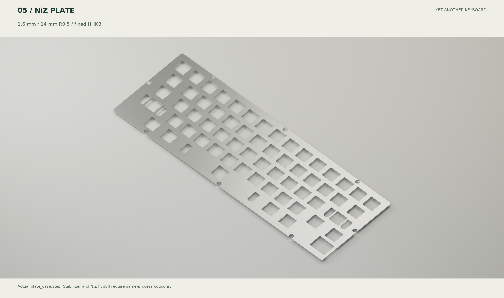
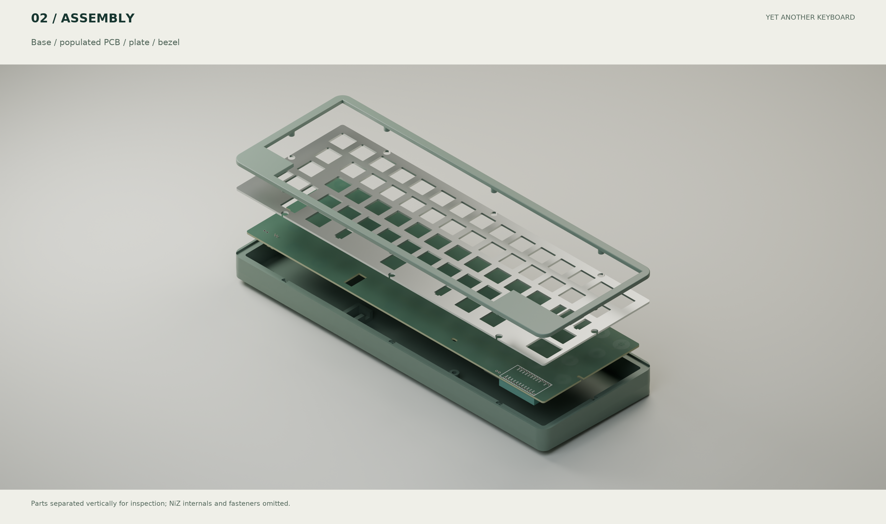

# YAKB A0 design

[简体中文完整说明](design.zh-CN.md). Date: 2026-10-22. **YAKB — Yet Another KeyBoard** is an engineering prototype with editable electrical and mechanical sources. The reports distinguish file-level checks from physical validation.

## Architecture

Use a socketable nice!nano v2/nRF52840 for BLE HID, USB HID and charging. This removes MCU, RF, clock and USB fine-pitch assembly from the user's soldering work. PH60 informs printed-case/battery design, Lot60 provides the GH60-style mounting reference, HSKB informs the true 6u HHKB layout, and Tako/EC60 inform the sensing mechanism. The Lot60 nRF52810 + CH554 circuit is not reused.

Five row outputs drive the 60 sensing cells through 100Ω resistors. Two SOIC-16 CD74HC4051M96 devices select 15 columns; they share A/B/C and SENSE, with mutually exclusive active-low inhibits. The unused channel is grounded. Each column has a 100k bleed resistor. SENSE has 220pF C0G to ground, a 1k drain connection and an OPA350UA non-inverting amplifier with 100k/1k feedback (gain 101). The output goes to SAADC AIN0 through **D19/P0.02**, not Arduino-style D18/A0.

The amplifier, muxes and sensing values follow a proven starting topology, but the gain, capacitor, noise margin and timing require an actual PCB. Target ADC swing is 0–3.3V, internal reference, 1/6 gain, 12-bit conversion. Do not infer calibrated travel in millimeters or Rapid Trigger support from ADC counts.

## Fixed HHKB mechanism

The row counts are 15/14/13/13/5. Control occupies the Caps position, right Shift is split into 1.75u + Fn, and the bottom row has 1.5u left blank, 1u GUI, 1.5u Alt, 6u Space, 1.5u Alt, 1u GUI and 2.5u right blank. Use a **centered MX-cross 6u cap with 95.25 mm stabilizer spacing**; offset-stem 6u, 6.25u and original Topre caps are not interchangeable. The two 2.25u keys use 23.8125 mm stabilizer spacing.

Columns are the integer 1u bins containing the key centers, leaving gaps in some rows. This keeps the physical bottom row from folding onto five leftmost columns. The PCB, transform, masks and coordinate table share this mapping. The HSKB firmware's apparent final-number-row x=15 entry is corrected to x=14u here.

Each key needs a housing, slider, silencing ring, dome and sensing conical spring. The official NiZ switch pack does not establish that domes or conical springs are included. Pressure-boost springs are not sensing springs. Use individually positioned domes or a deliberately adapted sheet matching this layout.

The initial NiZ plate is 1.6 mm thick with 14.0 mm R0.5 openings, based on Tako. Check 13.9/14.0/14.1 mm coupons in the final material and process. FDM coupons only establish rough fit. Stainless steel or FR4 is preferred for a full functional plate. The proposed Cherry-style plate-stabilizer cutouts are not approved for every vendor; test the latch, wire and NiZ housing interaction before cutting a complete plate.

## Shared dimensions and assembly

The PCB rear-left frame corner is (0,0), x points right, y toward the typist, and PCB top is z=0. CAD and DXF preserve the same coordinates without mirroring. DXF's conventional screen orientation may look inverted; identify Esc and Fn before changing orientation.

| Item | Design envelope |
| --- | --- |
| PCB | 285.0 × 94.6 × 1.6 mm; R2 corners; z=-1.6…0 |
| Pitch / first 1u center | 19.05 mm / (9.15,9.20) |
| Plate | bottom z=6.0, top z=7.6; tray envelope 285 × 94.6; own-case version 295 × 104.6 |
| Controller/socket | ~33.5 × 18 mm, 6.5 mm downward protrusion; bottom z=-8.1 |
| Complete protected cell | ≤60 × 35 × 5.5 mm; z=-11.144…-4.456 |
| Cell bay | 64 × 39 × 7 mm |
| Case | 299 × 108.6 mm; 2.4 mm sloped floor, rear outside z=-14.5 / front outside z=-10.8 |
| Bezel | z=7.6…10.6; nominal shell front 21.4 / rear 25.1 mm excluding feet/keycaps |

The 6 mm PCB-to-plate gap is an initial reference requiring real NiZ/dome measurement. The original case independently supports the PCB and plate; central tray posts must first be checked against housings and domes. Use them only as supports if a screw head would interfere. Do not bend the PCB or add arbitrary foam to compensate for wrong stack height.

The case uses eight bottom-up screws into blind M2 bezel inserts: three M2×20 rear, two M2×18 side, three M2×16 front. Bezel insert bores are Ø3.0 × 3 mm with a separate screw-tip relief and 1.5 mm top skin; test nominal OD3.2 × L3 inserts. The plate has open edge reliefs for these bosses. PCB support insert bores remain Ø3.3 × 4.5 mm. The lower-left tray clearance is bridged below with R33/C1 reliefs. The one-piece 299 mm case requires a sufficiently large bed or print service.

## Soldering and power

The 40 assembled component/module/harness positions comprise one nice!nano, two muxes, one amplifier, one SOT-23 AO3401A, 27 resistors, five capacitors and three connector/harness locations. There are no per-key diodes, hot-swap sockets, RGB, display or separate USB controller. Passives are imperial 0805/metric 2012 with extended solder pads; the analog ICs use 1.27 mm-pitch SOIC.

Use a protected 1S 3.7V LiPo with 4.2V full-charge voltage. Capacity is not a physical size guarantee: include PCM, wrapping and lead exit in the 60×35×5.5 mm envelope. Default charging is approximately 100 mA; leave BOOST open. A 1000 mAh pack therefore takes well over ten hours including the constant-voltage tail and operating load. Review cell limits, wiring, connector and temperature before considering the optional 500 mA mode. The physical switch disconnects the battery from the module, including charging; USB can still power the module separately.

A complete USB 2.0 data extension connects the module's left-facing USB-C to the traditional case opening. A charge-only lead or an arbitrary CC breakout is not equivalent. Cable plug envelopes, strain relief and signal integrity remain real-part checks.

## Low power and firmware

OPA350 typically draws about 5.2 mA; choosing ZMK alone does not make EC consumption comparable to a passive mechanical matrix. Q1 gates only the amplifier. The mux supply stays on to prevent address-pin backfeeding. Before amplifier-off, rows go low, both muxes disable and SENSE discharges. Keep the module's VCC enabled during EC polling.

Initial waits are 4/8/12 ms for active/idle/long-idle operation, with 200µs amplifier warm-up, 10µs discharge settling and 5µs pre-ADC settling. These intervals do not guarantee a 250 Hz frame rate or a particular BLE latency. Measure complete frames under radio activity. The reviewed patch restores fast polling on the first raw transition while retaining the two-frame press filter; pulses shorter than a frame interval can still be missed. Deep sleep is disabled until a separate reliable wake path exists.

At an assumed 80% usable capacity, a 1000 mAh pack gives 100/800/5333 hours for **assumed average currents** of 8/1/0.15 mA. These are mathematical scenarios, not measured typing/standby runtime. Measure at the cell under USB, charging, BLE, typing, idle and slow-scan conditions.

ZMK and the EC module are pinned; see the frozen west manifest, prebuilt UF2 files and build reports. Build success does not prove on-board analog performance. Use the calibrator to record empty/full values, noise, thresholds and hysteresis for the 60 valid positions, save explicitly and verify cold-start restoration. Test startup with a held key, short taps, slow release, chords, long holds and USB/BLE transitions. Fn+1/2/3 select BLE profiles, Fn+4 clears the current profile, Fn+H/J/K/L are arrows, and Fn+Esc enters the bootloader.

See the [soldering workbench](../hardware/soldering/index.html), [soldering order](soldering-guide.md), [compatibility](compatibility.md) and [reproduction](reproduce.md). No physical fit, RF, thermal or battery-life pass is claimed without a first-article record.

The revised original case uses R8 corners, a recessed lower skirt and a 1.95° wedge floor. Nominal shell front height falls from 25.1 to 21.0 mm; rear remains 25.1 mm. The cell follows the floor slope. The base STL is rotated flat for printing; STEP retains the shared PCB datum. See [case design](case-design.md).

The PCB uses four copper layers to retain 40 hand-solder positions and generous component spacing. Ordinary traces are 0.2 mm with 0.15 mm minimum necks and 0.2 mm clearance. Inner routing and pours are excluded within a 6 mm radius of each sensing center; existing through vias are permitted. The RF keepout covers every copper layer. No solid inner power/ground planes are added. Thickness stays 1.6 mm; noise and dynamic range require hardware measurements.

## Reviewed revision

37 native library component models now participate in 16 collision checks, all clear. Fixes cover the R33/C1 bridge, USB plug/U4 collision, U1 orientation and all 30 through-hole mask openings. J1 is horizontal S2B-PH-K; U2/U3 are TI CD74HC4051M96. The plate has a 21×16 mm RF window beneath the right blocker; prefer copper-free FR4/G10 and retain the window even with a metal plate. Bottom screws leave the top face uninterrupted; the skirt inset is now 1.0 mm to preserve counterbore wall thickness. See the [fix record](review-fixes.md) and [electrical, interference and power analysis](electrical-analysis.md).
