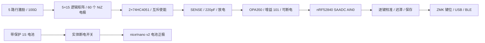
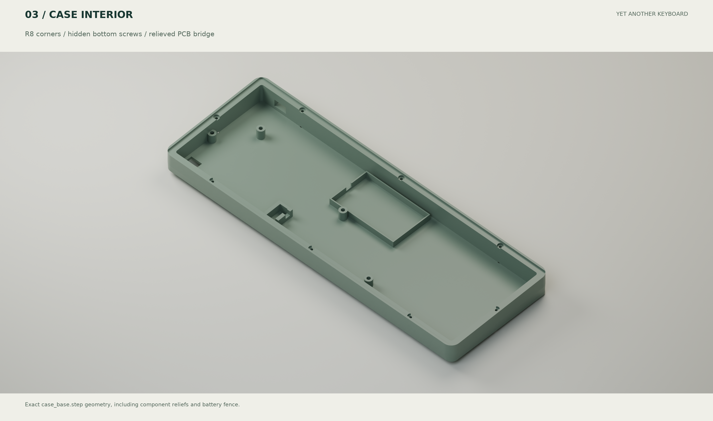

# YAKB A0 设计说明

日期：2026-10-22。名称：**YAKB — Yet Another KeyBoard**。这是一份包含可编辑电气与结构文件的工程原型设计；任何未完成的验证以检查报告为准，不以 CAD 外观判断可量产。

## 1. 选定架构及参考范围

PH60 提供打印壳、电池布置及多配列的参考；Lot60 提供传统 GH60 托盘孔槽、USB 位置的实测文件基准；HSKB 提供 6u HHKB 布局参考；Tako 与 EC60 提供 NiZ 机构和电极 / 前端参考。没有直接把 MX 板换成 NiZ，也没有沿用 Lot60 的 nRF52810 + CH554 双芯片电路。

首版采用一个 nRF52840 主控，USB HID 与 BLE HID 均由 nice!nano v2 完成。模块包含射频、时钟、稳压、USB-C 和充电器；用户只焊接较大的通孔引脚。拒绝用“Pro Micro 脚位兼容”推断所有廉价克隆的电池、稳压、充电和待机表现相同；克隆板需另做适配。

## 2. HHKB 固定配列

行键数为 **15 / 14 / 13 / 13 / 5 = 60**。数字行末为两个 1u 键；第二行 Backspace 为 1.5u；Control 为 1.75u；左 Shift 2.25u；右 Shift 1.75u + 1u Fn；底行为左侧 1.5u 空白、1u GUI、1.5u Alt、6u Space、1.5u Alt、1u GUI、右侧 2.5u 空白。

这不是常见 7u HHKB 风格底行，也不是 ANSI 61 键。6u 空格明确选择**中心十字接口、两个卫星轴中心相距 95.25 mm**的组合；偏心 6u、原装 Topre 空格或 6.25u 键帽不能直接替换。两处 2.25u 大键的卫星轴间距为 23.8125 mm。1.75u 右 Shift 无卫星轴。

逻辑列按键位中心所在的 1u 区间编号（向下取整）；每行可有空列。这样避免把横跨底行的五个键挤到左侧五列。电极、固件 transform、mask 和键位表使用同一坐标映射。HSKB 原固件布局中有一个数字行末 `x=15` 条目，本设计没有照抄该坐标，而是把第 15 个 1u 键设为 x=14u。

## 3. NiZ 机构与定位板

每键需要轴壳、滑块、消音圈、胶碗和感应锥簧。NiZ 官方轴体套件说明仅列滑块 / 壳 / 消音圈，不能假设包含胶碗与锥簧。采购以样品和卖家确认的完整套件为准；加压小弹簧不是感应锥簧。

板厚 1.6 mm、开孔 14.0 mm、角 R0.5 是 Tako NiZ 板的起始参考。NiZ 不同代际和供应商不能共用未经确认的尺寸。先做 `niz_fit_coupon`，验证 13.9 / 14.0 / 14.1 mm 三个孔的松紧、卡扣闭合、轴壳方向、滑块运动；FDM 试片只能排查粗略尺寸，最终需使用与正式定位板相同材料、厚度和加工工艺的试片。

正式首版优先 1.6 mm 不锈钢或 FR4；打印定位板用于尺寸试装，不作为同等刚度和寿命的替代。硅胶碗需要 HHKB 配列的分体碗，或经过可靠定位的裁切胶碗；整张 ANSI 胶碗不能默认对齐。定位板和 PCB 之间不放任意厚泡棉去改变胶碗预压。

卫星轴采用板装 Cherry 类型候选开孔（6.75 × 12.3 mm 主孔 + 后侧卡扣颈部），**尚未绑定某一实物品牌**。这些开孔必须通过试片；不能拿该 DXF 直接宣称兼容所有 Cherry / Costar / 原装 Topre 卫星轴。NiZ 轴壳底部与大键钢丝、卫星轴壳是否干涉也须确认。

## 4. 统一坐标和高度

PCB 左后侧理论外框角为 (0,0)，x 向右、y 向使用者，PCB 上表面 z=0。CAD 和 DXF 与 PCB 使用同一个坐标，不在导出时镜像。DXF 中的 y 轴在通常 CAD 视图会朝上显示，识别方向请以 Esc 和 Fn 坐标为准，不能通过“看起来倒了”便镜像加工。

| 结构 | 设计值 / 外包络 |
| --- | --- |
| PCB | 285.0 × 94.6 × 1.6 mm，四角 R2；z=-1.6…0 |
| 键距 | 19.05 mm；首个 1u 中心 (9.15,9.20) |
| 板间净距 | PCB 上表面到定位板下表面 6.0 mm，需样品确认 |
| 定位板 | z=6.0…7.6；托盘版 285 × 94.6；自有壳版 295 × 104.6 |
| 主控及低矮插座包络 | z=-8.1…-1.6，约 33.5 × 18 mm；最小模型净空约 0.56 mm |
| 电池包络 | 60 × 35 × 5.5；z=-11.144…-4.456；下方 0.75 mm，含绝缘和浮动空间 |
| 电池仓内尺寸 | 64 × 39 × 7 mm；不以泡棉压紧电池 |
| 自有壳 | 外形 299 × 108.6；底厚 2.4；后底 z=-14.5，前底 z=-10.8 |
| 上框 | z=7.6…10.6；标称前高 21.4 / 后高 25.1 mm，不含脚垫和键帽 |

6 mm 板间距源于成熟 NiZ/Tako 结构的初值，不能由胶碗高度的猜测替代实测。模型没有真实滑块、胶碗、键帽、卫星轴和拔插中的 USB 线壳，所以“包络无相交”只覆盖报告列出的对象。

PCB 和定位板分别由底壳支撑柱和上沿承托，高度通过壳体共同约束，**不使用 MX 铜柱直接穿过胶碗区域**。传统托盘中间柱可能紧邻轴壳、胶碗，不能只检查电极是否碰到孔。装配时优先利用外围安装点，中央位置先作支撑点；只有真实机构确认有空间时才安装小头螺丝。PCB 不可因拧紧而弯曲来补高度误差。

## 5. PCB 与手焊硬件

感应面复用 Tako 的无环电极封装：1=行激励，2=列感应，3=接地护线。感应铜保持阻焊覆盖，不刷锡、不贴导电泡棉、不在弹簧座区域涂厚层涂覆胶。不能把电极下方全铺铜理解为越多越稳定；封装已有禁铺铜区域。

| 器件 | 数量 | 封装 / 作用 |
| --- | --- | --- |
| nice!nano v2 | 1 | 成品模块，通孔引脚，建议低矮可插拔安装 |
| CD74HC4051M96 | 2 | SOIC-16，1.27 mm 脚距，15 列，余下 X7 接地 |
| OPA350UA | 1 | SOIC-8，1.27 mm 脚距；不选 MSOP / VSSOP 版本 |
| AO3401A | 1 | SOT-23；仅切换运放电源 |
| 100Ω 行电阻 | 5 | 0805 手焊焊盘 |
| 100kΩ 列泄放 | 15 | 0805 |
| 反馈 / 放电 / 使能 / 栅极电阻 | 7 | 0805；数值和网络见原理图 / BOM |
| 电容 | 5 | 3×100nF，1×220pF C0G/NP0，1×1µF；0805 |
| 电池座 / 开关线位 / Reset 线位 | 3 | 通孔；开关和 Reset 接线孔不是厂商专用封装 |

共 40 个板上实装元件 / 模块 / 线位，另有 60 个不焊轴脚的感应单元。没有逐键二极管或热插拔座。0805 指公制 2012，不是更小的公制 0805（英制 0201）。

充电电流默认约 100 mA，不桥接 nice!nano 的 BOOST。1000 mAh 电池因此需要十余小时的充电时间，完整时间受恒压尾段和使用负载影响。若后续确需 500 mA，须在电芯允许电流、USB 延长线额定值、温升以及电池导线尺寸均确认后另行评审。实体开关断开后电池正极与模块分离，因此开关关闭时不能给电池充电；USB 仍可单独供模块工作。

## 6. 模拟前端与低功耗

两个 4051 共用 A/B/C 地址线，INH 各自控制；两路 COM 接同一个 SENSE，任何时刻只能有一个 MUX 的 INH 为低。未使用的第 16 通道接地。每列使用 100k 泄放电阻。SENSE 接 220pF C0G 对地，并接 OPA350 正输入；反馈 100k / 1k，非反相增益 101。DRAIN 通过 1k 接 SENSE，采样前拉低放电，测量时高阻。

运放增益、220pF 和采样时序是已有电路的起始值，不是已测的最优值。输出必须限制在 ADC 实际允许电压内；本版目标 0…3.3 V，SAADC 使用内部参考、1/6 增益、12 位、AIN0。检查饱和、未按下噪声、按到底动态范围以及多键串扰后才能锁定参数。

**D19=P0.02/AIN0 才是本版 ADC。** nice!nano 的 D18=P1.15 不是 ADC，不能照搬 Arduino 的 A0 命名。完整 GPIO 见 `design/pin-map.csv`；P0.13 保留给模块自己的 VCC 开关，未拿来驱动 EC 电路。

OPA350 典型静态电流约 5.2 mA，它不是微安级运放。Q1 只切运放电源；MUX 保持供电，避免地址线高电平向失电 MUX 反向灌电。关断前保证行线为低、两个 MUX 禁用、SENSE 已放电；模块 VCC 在正常 EC 轮询时保持启用。

起始扫描参数：活动等待 4 ms、空闲 8 ms、长时间空闲 12 ms；运放预热 200µs、放电建立 10µs、ADC 前等待 5µs。这些是**等待间隔**，不保证整帧 250 Hz 或某个蓝牙端到端延迟；帧耗时和 BLE 抢占必须测量。修补后的驱动在第一次原始状态变化时即恢复快扫，保留两帧按下确认；短于扫描周期的脉冲仍不能保证捕获。没有外部唤醒电路，故本版关闭 ZMK 深睡眠，采用可扫描的空闲状态，不能承诺深睡后任意键唤醒。

1000 mAh 电池按 80% 可用容量计算：平均 8 mA / 1 mA / 0.15 mA 对应约 100 / 800 / 5333 小时。这是三种假设电流下的数学结果，**不是测得的打字 / 待机续航**。实际电流应分别记录 USB、充电、BLE 连线、打字、空闲和慢扫描状态；用电池端实测平均电流重新计算。

## 7. 固件与校准

配置锁定 ZMK 和 EC 模块的提交号，包含 GPIO、15 列 MUX 输入、5 行 mask、60 键 transform 和两层键位。Fn+1/2/3 选择蓝牙槽位，Fn+4 清除当前槽位配对，Fn+H/J/K/L 为方向键，Fn+Esc 进入 bootloader；实际功能以成功编译和上板测试记录为准。

初装必须校准 60 个有效位置，记录空载值、按到底值、噪声、触发和释放迟滞，保存后冷启动复核。跳过所有未安装位置，不能向 5×15 的空位注入“已按下”状态。上电按住键、轻触后立即释放、多键同时按下、长期按住和 USB/BLE 切换都要测试。校准后只有显式保存时才写 Flash。

使用模块 `enable_ec_calibrator` snippet 启用串口 shell 和校准器，再通过 `ec` 命令补全确认设备名与 `calibration start/save/load/export`。命令的存在不等于已经提供 Rapid Trigger 或以毫米标定的触发深度；本设计不声称这些功能。

## 8. 首件验收

先完成试片和小矩阵，再制造完整 A0 原型。验收记录应包含：电源和栅极波形、采样噪声和动态范围、逐键校准数据、按键 / 大键回弹、胶碗预压一致性、天线周围真实导体位置、蓝牙重连 / 释放事件、充电温升、壳内电池固定方式、PCB/定位板平整度及六个托盘孔位。当前检查报告只证明它明确列出的文件和包络条件。

自有壳外框采用 8 处底部 M2 固定，上框盲孔 Ø3.0×3 mm 配名义外径3.2×长3 mm 螺母，螺钉尖端另有避让孔，正面保留1.5 mm皮层；PCB支柱孔仍为Ø3.3×4.5 mm。后排/两侧/前排分别用M2×20/18/16，必须按实物螺母试片验证。

[交互焊接工作台](../hardware/soldering/index.html)支持离线逐步定位和本地进度保存。

自有壳已按外观反馈重做为 R8 大圆角、内收下裙和约 1.95° 浅楔形：前高由 25.1 降至 21.0 mm，后高 25.1 mm；电池随内底面倾斜。`case_base.stl` 已旋转为底面贴合 z=0 的打印姿态，STEP 继续保留 PCB 坐标。详见[外壳改版与来源](case-design.zh-CN.md)。

主板采用四层，以保持 40 个手焊板位和宽松元件间距；普通走线 0.2 mm、局部颈缩最小 0.15 mm，间距 0.2 mm。内层在每个感应中心半径 6 mm 内禁止走线和铺铜，允许原有贯通孔；天线禁布区覆盖全部铜层。没有添加整面内层电源/地平面，需在实物上验证噪声及动态范围。板厚仍为 1.6 mm。

## 2026-10-22 复核修订

当前上框正面无孔，8 颗外壳螺丝全部从底面锁入。后排 M2×20、两侧 M2×18、前排 M2×16；上框盲孔保留 1.5 mm 顶部皮层，名义 M2 螺母外径 3.2×长3 mm。定位板改为边缘螺母柱避让口。下裙内收改为 1.0 mm，以保留沉孔壁厚；前后壳高不变。详见焊接指南。

37 个 KiCad 标准器件模型纳入碰撞测试，16 组指定对象交集均为零。已修复桥墩与 R33/C1、USB 插头与 U4 的碰撞，以及 U1 朝向和 30 个通孔阻焊开窗。J1 指定水平 S2B-PH-K；U2/U3 指定 TI CD74HC4051M96。右侧挡块下定位板新增 21×16 mm 天线开窗。首选无铜 FR4/G10 定位板；金属板也必须保留该窗。

[完整修复记录](review-fixes.zh-CN.md)与[电气、干扰和功耗分析](electrical-analysis.zh-CN.md)列出证据与尚需首件验证的边界。
