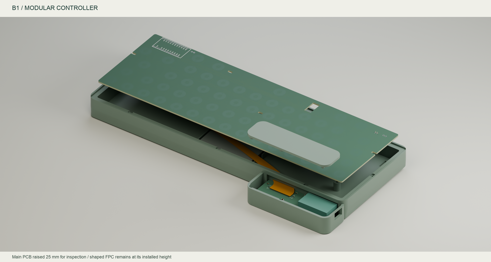

# YAKB B1.1：独立主控载板 + 异形 FPC

[English](README.md) · [接口逐针表](../../hardware/modular/FPC-pinout.csv) · [B1 焊接工作台](../../hardware/soldering/b1/index.html) · [合并电子 BOM](../../hardware/modular/BOM-B1-complete.csv) · [增量 BOM](../../hardware/modular/BOM-B1.csv)

B1 将 nice!nano 从主板右前方移到后左侧独立载板。USB-C 从后左角的**左侧面**直接插入模块，不再依赖内部 USB 延长线。主板只保留静电容扫描前端；原 U1 位置安装无源转接板，**不能再安装第二块主控**。现有 A0 主板、HHKB 上框和定位板可继续使用，B1 使用专用底壳与后舱盖。

这是可审查的工程原型文件，尚未实物验证。特别是连接器插接尺寸、FPC 补强、模块安装高度和 USB 插头实配，必须在制造整机前完成核对。Gerber 可用于询价和工程样件，不能当成已经量产验证。

采购与装配使用[合并电子 BOM](../../hardware/modular/BOM-B1-complete.csv)，另配[模块 / 外壳增量 BOM](../../hardware/modular/BOM-B1.csv)。46 个实装板位 / 接线位置之外另有 1 条 FPC，主板 U1 禁装、60 个电极免焊；数量按装配位置计，JMAIN 一组包含 24 根针。各小板 CSV 坐标取原生封装原点，不取焊盘平均值；JMAIN 原点为 (0,0)，引脚组中心为 (20,9.5)。完整版本关系见[文件版本表](../file-map.zh-CN.md)。

## 文件与结构

| 部件 | 文件 / 尺寸 | 装配定义 |
| --- | --- | --- |
| 感应主板 | [A0 PCB](../../hardware/YAKB.kicad_pcb)，285 × 94.6 × 1.6 mm，4 层 | 其余元件照常实装，U1 不装主控 |
| 主控载板 | [B1 PCB](../../hardware/modular/YAKB-controller-B1.kicad_pcb)，82 × 24 × 1 mm，2 层 | U1 nice!nano 在顶面，USB 朝左，天线朝右；JF1、1 nF、100 nF |
| 主板转接板 | [B1 PCB](../../hardware/modular/YAKB-interposer-B1.kicad_pcb)，40 × 19 × 1 mm，2 层 | 24 根直针连接原 U1 孔；JF1 与 47 Ω 均朝主板侧；板间净距 2.6 mm |
| 定制软板 | [FPC PCB](../../hardware/modular/YAKB-shaped-FPC-B1.kicad_pcb) | 24 路独立导体，1 mm 端子间距，端宽 25 mm、中段 X 方向截面最大 26 mm，定位耳处 26.1 mm；不是通用直条排线 |
| 底壳 | [单仓 STL](../../mechanical/modular/case_base_B1.stl)、[三仓 STL](../../mechanical/modular/case_base_B1_three_bay.stl) | 最大平面外包络 299 × 136.6 mm，只有左后部增加 28 mm 深度；前部高度与 A0 一致 |
| 后舱盖 | [STL](../../mechanical/modular/pod_lid_B1.stl) | 底部 2 颗 M2×16 锁入盲孔嵌件，正面无螺丝；另用 4 颗 M2×4 固定载板 |
| 总装 | [STEP](../../mechanical/modular/assembly_B1.step) | 交付坐标 X 向右、Y 向后、Z 向上；主板顶面 z=0 |

两张刚性小板、整条 FPC 和短 FPC 试片均附同名原生原理图、PDF、KiCad 工程及独立加工 ZIP，见 [hardware/modular](../../hardware/modular/) 和 [fabrication/modular](../../fabrication/modular/)。主板和定位板加工文件仍取 A0。装配转换时只保留一个 nice!nano。

图中主板向上分离 25 mm、后舱盖上移 60 mm，便于看清下面的软板；不是安装高度。模块、USB 插头、电池和键帽是明确的净空包络；两张小板上的连接器与阻容来自原生 KiCad 模型。渲染输入及哈希见 [manifest](../../assets/modular/render-manifest.json)。

USB 端下方增加塑料边缘支承，前侧卡唇与后舱盖压柱限制抬起，名义竖向间隙 0.30 mm，避免主控一侧成为约 48 mm 的悬臂。安装时先将左前板边插入卡唇，再落下载板、锁内部螺丝并合盖；须用实际打印件检查卡唇与插拔力。

打印 STL 已单独定向：底壳以斜底平面落床，后舱盖外表面朝床、压柱朝上；装配 STEP 保持整机坐标。

USB 插头的塑料外壳验收包络为 **12 × 8 mm**，壳孔为 **14 × 10 mm**，底壳与后舱盖共同避让，盖板剩余厚度 1.85 mm。当前插口中心与凹入深度属于待实测装配基准；先打印 [96 × 34.4 mm 后舱试件](../../mechanical/modular/rear_pod_fit_coupon.stl)，配合原后舱盖、实际载板/模块及线缆检验。试件从当前底壳裁出，前侧开口，不是可替代完整底壳的独立产品。

## 电源、引脚与接触面

两端采用 **Molex 200528-0240，24 pin / 1 mm / 底接触 / 1.9 mm 高**。厂商页面列出最大 1 A/触点、20 次插拔，并提示在线资料有限；这些额定值不代表本软板允许 1 A。[Molex 产品资料](https://www.molex.com/en-us/products/part-detail/2005280240)

载板端 JF1 为 A，转接板端 JF1 为 B，B 旋转 180°。本定制软板按 **A1→B24、A2→B23……A24→B1** 布线，同一物理面露铜接触。端子侧别、1 脚和导通必须逐针实测，不能仅凭“同面排线 / 反面排线”的商品名称代换。两个插座安装朝向相反，转接板网络定义已相应反序；这不是电气信号交换。

A 端功能顺序：`GND, VCC, GND, ROW0…ROW4, GND, MUX_A, MUX_B, MUX_C, MUX0_INH, MUX1_INH, DRAIN, AFE_ON_N, GND, ADC_FLEX, GND, RESET, GND, BAT_SW, BAT_SW, GND`。以逐针 CSV 和原生 PCB 为准。

- 电池仍接主板 J1，经主板 SW1 后成为 BAT_SW，通过两根并联正极导体送到主控；主控充电电流沿同一路径返回电池。七根 GND 导体在两张刚性板上并联。VCC 从主控送回模拟前端。
- USB D+/D−、CC 和 VBUS 均留在成品 nice!nano 内，**不经过 FPC**。保留 USB HID / BLE HID 双模，Fn+5 / Fn+6 切换，固件 GPIO 映射不变。
- 不将高阻 SENSE、反馈 FB 或原始电极信号引出主板；软板只传运放输出。主板转接端串 47 Ω，载板 ADC 端接 1 nF C0G 到地；另一颗 100 nF 为 VCC 去耦。0805、SOIC 和通孔仍是主要手焊封装；1 mm 插座需要助焊剂和放大检查，无裸 QFN / RF 匹配网络焊接。

固件继续使用现有 `firmware/prebuilt/yakb-a0.uf2` 和 `yakb-a0-calibrator.uf2`；文件名保留原 shield 标识。B1 未改变 GPIO，新增 ADC 滤波后仍须重新采集基线并校准。

## FPC 制造约束与待确认项目

软板按**单面 B.Cu、35 µm 铜、0.20 mm 名义成品厚度**询价；KiCad 至少保留两个逻辑铜层，但 F.Cu 无铜且加工包不输出 F.Cu。非插接区采用柔性覆盖膜；B.Mask 用每端一片连续区域表示露铜窗口，不是要求做普通 FR4 绿油。线宽 0.15 mm、最小间距规则 0.10 mm、铜到板边规则 0.20 mm。端子改为 0.7 × 3.5 mm 露铜指，铜指到插入端边缘；25 mm 端部带定位耳，采用整片覆盖膜开窗。补强在非接触面，长度至少 5 mm，端部成品厚度 0.30 ± 0.05 mm。金层至少 0.1 µm、镍底层 1–5 µm，不能只填写未保证厚度的默认表面处理。这些名义值来自已核实料号表的厂家图，并不表示实物已通过验配。见[接口修正与试片](interface-review.zh-CN.md)。

不能直接用普通双面 FR4 板厂默认堆叠下单这张软板。已取得包含 2005280240 的厂家系列图，端部名义几何和 4 mm 插深已经录入；未标注的槽高、制造公差、锁止与接触仍须实配。先用新增的 [25 mm 长短试片](../../hardware/modular/YAKB-FPC-coupon-B1.kicad_pcb) 验证，不直接制造整条软板；询价时明确这是静态安装 FPC。成品沿平面弯曲外形制造，安装时不需要把直排线强折成曲线。预留轻微竖向装配顺应性，不能把 0.20 mm 模型当成可承受拉力的结构件。

转接板净距 2.6 mm 来自当前堆叠；插针需用绝缘定高夹具焊接、剪齐并检查与底壳的净空。插座开盖需要先拆主板，不支持带电插拔。nice!nano 本体及 USB 口目前用保守包络表达，采购批次的插针安装方式、实际 USB 口中心与插头外壳需先实配，必要时只调整后舱孔和载板高度后重跑净空检查。

## 干扰、功耗和验证边界

天线移到主板、金属定位板投影之外；载板全铜层禁布区为本地 `x=26.27…43.27, y=6.5…18.5 mm`。该区没有安装螺丝或 FPC。塑料后舱盖不能认证蓝牙性能；USB 插头金属、嵌件、手部和电池仍可能改变匹配与重传。应比较裸板/闭壳、插 USB/纯电池、单仓/三仓时的 RSSI、断连、按键释放与丢键。

软板约 0.23 m 长，数字线与模拟输出共行；GND 邻线改善回流，但没有连续屏蔽层或受控阻抗。ADC 两侧夹 GND，47 Ω + 1 nF 的理想时间常数约 48 ns，12 bit 满幅阶跃建立到半 LSB 约 0.43 µs；它不包含运放、分布电容与无线抢占，不能替代实测。当前 5 µs 预采样和 10 µs SAADC 采集先保留；测第一帧、最近/最远键、相邻多键、充电及 BLE 高负载后再决定是否延长。高阻 SENSE 原有长线风险仍在，见 [A0 电气分析](../electrical-analysis.zh-CN.md)。

以铜电阻率 0.01724 Ω·mm²/m、0.23 m、0.15×0.035 mm² 截面估算，每根约 0.76 Ω；两根 BAT_SW 和七根均匀分流 GND 的理想回路约 0.49 Ω，100 mA 时约 49 mV / 4.9 mW，另加接插件、刚性板走线和插针。实际回流不一定均分。仅按七根地线均分，100 mA 充电也可能在两板地之间产生约 11 mV 的直流差，ADC 可能看到基线偏移；必须比较充电、纯 USB、纯电池三种状态的空载/按下分布，不能只测静态连通。正极压降也会影响电芯端恒压尾段和电量读数，应在电芯端测量。默认充电仍为约 **100 mA，BOOST 不桥接**；不可按触点 1 A 的额定值提高充电电流。

新增电阻/电容不引入明显直流静态负载；软板电容及 RF 重试会增加动态功耗。以 12 根数字线、每根 10–100 pF、5 kHz 有效充放电频率和 3.3 V 作假设，额外平均电流约 2–20 µA，不能当成实测上限。另外，按 7 ms 帧周期、每帧 60 次完整 3.3 V 充放电的保守假设，1 nF ADC 滤波电容另计约 28 µA；实际摆幅通常更小，这也不是实测上限。加到 A0 的约 3.92 mA 活动中间估计后，1000 mAh / 80% 可用容量约为 202–203 小时连续活动；B1 未实测，不承诺续航改善。大电池包继续只用工厂成组、单保护板的 1S2P/1S3P，禁止自行并联独立电芯。

原生检查覆盖连接、24 路跨板映射、原 U1 孔位、布线和所选 CAD 净空，见 [电气报告](../../reports/modular/) 与 [机械报告](../../reports/modular-mechanical.json)。ERC 使用物理管脚的 passive 符号，并不重新审核 nice!nano 内部电路。未仿真阻抗/EMC，也未完成 NiZ、充电、无线、插接与打印公差实测。

计算采用保存的原生 FPC 走线长度，精确值和假设见 [B1 电气计算](../../reports/modular-electrical.json)；用 KiCad Python 运行 `scripts/analyze_modular.py` 可复算。

## 复现

1. KiCad Python 运行 `scripts/generate_modular_pcbs.py`，生成未布线源与 DSN；用 FreeRouting 路由两个 DSN，生成同名 SES（需要人工保留安装孔和天线禁布区）。
2. KiCad Python 依次运行 `scripts/finish_modular_pcbs.py`、`scripts/generate_modular_flex.py`（同时生成短试片）；前者从 `.render-cache/*-unrouted.kicad_pcb` 导入 SES，不会叠加旧走线。
3. 项目 `.venv/bin/python scripts/export_modular.py` 进行原生检查、导出加工及 GLB/STEP；KiCad Python 运行 `scripts/verify_modular.py` 检查逐针连接并提取原生图形。
4. 项目 Python 依次运行 `scripts/generate_modular_mechanical.py`、`scripts/verify_interface_samples.py`、`scripts/render_modular.py`，再运行 `scripts/generate_soldering.py` 和 `scripts/generate_modular_guide.py`，分别刷新基础及 B1 指南。KiCad Python 另运行 `scripts/analyze_modular.py`；最后运行项目 Python 的 `scripts/verify_release.py`、`scripts/verify_modular_release.py` 与 `scripts/verify_repository.py --native`。Blender 路径位于渲染脚本，其他运行时要求同 [复现说明](../reproduce.zh-CN.md)。
