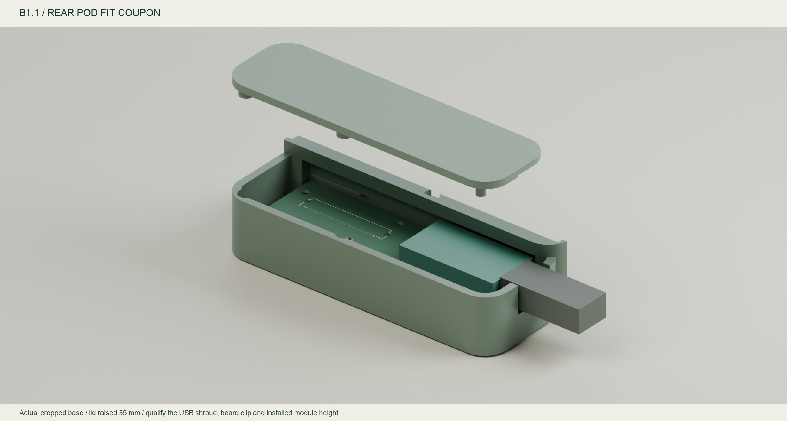

# B1.1 interface corrections and sample qualification

[中文](interface-review.zh-CN.md) · [Interface contract](../../design/fpc-interface.json) · [Assembly notes](README.md)

The reference is Molex-authored `2005281000-SD`, revision C, released 2019-08-14: PDF page 5 lists **2005280240**, and page 6 defines the terminal. [Manufacturer drawing mirror](https://www.micro-processor.com/parts-file/c2-2005280050.pdf). The URL, SHA256 and page numbers are recorded; the proprietary PDF is not redistributed. This establishes drawing provenance, not acceptance of purchased samples.

| Item | Previous B1 | Current B1.1 |
| --- | --- | --- |
| Tab width | 24 mm | 25 mm with locating ears |
| Exposed fingers | 0.6 × 4 mm, set back from the edge | 0.7 × 3.5 mm, reaching the insertion edge |
| Location/retention | No ears | Bilateral locating ears and rounded corners; see contract |
| Coverlay | Separate narrow windows per finger | One continuous opening per end |
| Stiffener | Text assumption, no added solid thickness | 5 mm on the non-contact face; CAD terminal totals 0.30 mm |
| USB plug envelope | 8 × 5.5 mm | 12 × 8 mm design acceptance envelope; 14 × 10 mm opening |
| USB opening | Base only | Base and lid cut together, retaining 1.85 mm lid roof |

The drawing permits tabbed and untabbed ends. This revision selects the tabbed option; absence of ears alone was not a nonconformance. The confirmed old dimension errors concern tab width and finger geometry.

The earlier zero-DRC result checked the old file, not conformity with the mating drawing. B1.1 retains copper-spacing checks. A negative edge-clearance rule permits only the insertion-edge pads to terminate at the cut edge, and each terminal footprint permits its own merged coverlay aperture. These reflect the terminal structure; rigid-board and other-copper rules remain effective. Separate checks cover nominal terminal dimensions, both 4 mm insertion datums, continuity and continuous openings.

A separate [short-FPC envelope STEP](../../mechanical/modular/fpc_mating_coupon_envelope.step) includes the stiffened ends; the `-native.step` export has uniform KiCad board thickness and does not establish stiffener thickness. [Sample file checks](../../reports/modular/sample-checks.json) verify the actual crop, installed-flex containment and bed alignment of all four delivered printable STLs.

## Make two samples first

1. [Short FPC fabrication ZIP](../../fabrication/modular/YAKB-FPC-coupon-B1.zip): 25 mm tip-to-tip, using the same end-outline function and contract as the installed flex. Bench mating/continuity only; not installed in the keyboard or a generic FFC substitute. Supply its `FLEX-STACKUP.json` to the flex fabricator and quote coverlay, stiffeners and finish together.
2. [Rear-pod base coupon STL](../../mechanical/modular/rear_pod_fit_coupon.stl): cropped directly from the current base, retaining the USB opening, carrier posts, bearing collars and edge clip. Use the [same pod lid](../../mechanical/modular/pod_lid_B1.stl). The real sloped floor is oriented on the print bed; the front is an open cut section.

[Download the bilingual measurement CSV](qualification-checklist.csv). Every result remains pending; no physical acceptance data is fabricated.

## Record measurements before full fabrication

| Check | Drawing/design target | Measurement |
| --- | --- | --- |
| Purchased part and lot | Molex 200528-0240; no appearance-only substitution | Pending |
| Finished tab thickness | 0.30 ± 0.05 mm including adhesive/stiffener | Pending |
| Insertion/retention | Nominal 4 mm; no lifting or abnormal resistance when locked | Pending |
| Continuity | Power off: A1→B24 through A24→B1; no adjacent shorts | Pending |
| Installed module height | Measure carrier top to actual USB centre with the selected pins/sockets | Pending |
| USB recess and cable | Measure receptacle face relative to outer wall, shroud size and complete insertion | Pending |
| Edge clip | 1 mm carrier, nominal 0.30 mm vertical play; no component pressure | Pending |
| Plug force | No significant PCB flex, movement or port load caused by enclosure misalignment | Pending |
| ADC and charging | Record noise/current on USB-only, battery-only and charging+BLE | Pending |

The 12 × 8 mm USB value defines the accepted shroud envelope; it is not a universal cable dimension. The manufacturer gives the nice!nano's overall thickness as 3.2 mm, which does not define its port centre height. The 6.5 mm module/mounting envelope is also not a precise vendor model. [Official nice!nano specifications](https://nicekeyboards.com/nice-nano/)

Completed checks concern drawings/files, native electrical rules and selected solid clearances. Physical rows remain unfilled; this revision must not be described as physically qualified.
