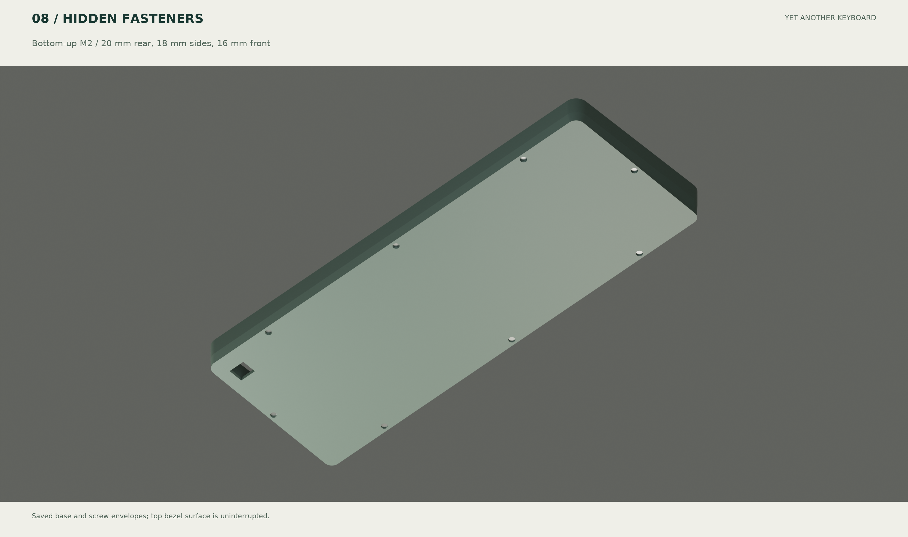

# YAKB A0 review and corrections

[简体中文](review-fixes.zh-CN.md) · [Electrical analysis](electrical-analysis.md) · [Battery options](battery-options.md) · [Soldering workbench](../hardware/soldering/index.html)

This review covers the saved PCB, native component solids, mechanical envelopes, EC driver and delivered outputs. A0 remains a prototype awaiting physical validation.

| Finding | Correction and evidence |
|---|---|
| Thirty plated pads were masked; a shared copper layer set was mutated | Copy the layer set before adding both mask layers; inspect all 30 native pads and Gerber openings on each side. Sensor copper stays masked and paste-free |
| Actual U1 USB direction disagreed with the case | Correct U1 orientation, module and plug envelopes; inspect pins 1/24 |
| USB plug collided with U4; bridge collided with R33/C1 | Move U4/C3, reroute affected nets and cut two bridge reliefs; inspect intersections with native component solids |
| Ambiguous battery connector and incorrect MUX ordering code | Specify horizontal JST S2B-PH-K and TI CD74HC4051M96; synchronize schematic, PCB, BOM and instructions |
| Visible top screws | Eight bottom-up M2 screws with blind bezel inserts: rear 20/side 18/front 16 mm. Continuous top surface and actual plate reliefs |
| Plate covered the antenna projection | Add a 21×16 mm metal-free window; prefer copper-free FR4/G10. Metal-case RF behavior remains unverified |
| Slow polling could delay first press/release; zero-noise calibration could divide by zero | Raw transitions resume fast polling; release resets idle timer; reject invalid calibration; clamp the SNR divisor to 1 while retaining measured zero noise |
| Packaged firmware could diverge from the current driver/config | Rebuild both UF2s; verify driver, object chronology, DTS and allocated ELF section bytes against UF2; record input hashes |
| Washed-out renders and geometry drift | Controlled Cycles lighting/exposure; saved STEP/native GLB for 3D and actual DXF/copper for 2D; input/output hashes for all 27 rendered outputs |

## Validation

- Native ERC, DRC including schematic parity and airwires: zero. Cross-check 309 physical pins.
- Thirty-seven native library component models; explicit module, battery, plug and keycap envelopes. Sixteen core mechanical intersection pairs are clear. Unavailable NiZ internals are outside this check.
- Normal and calibration firmware actually build with USB and BLE enabled. Fn+5 selects USB; Fn+6 selects BLE; one output endpoint at a time.
- Actual EC driver functions pass 960 phase/frame-duration combinations, 60-position mask/release tests, invalid calibration and constant-ADC zero-noise calibration. The 28 ms model bound is not measured hardware latency.
- Three 60×35×5.5 mm pouch envelopes fit at the existing height. An optional base and shared protection-board envelope are delivered; capacity remains a sourcing target.
- `scripts/verify_release.py` checks render provenance, PCB reports, Gerber ZIP and UF2 consistency.

## First-article uncertainties

High-impedance SENSE routing totals approximately 162.1 mm across branches; ADC totals 58.7 mm. Passing DRC does not prove analog margin. Measure pressed/released signals, charging noise, USB-cable coupling, BLE/Wi-Fi coexistence and cell current. Insufficient margin requires tighter MUX/amplifier/feedback placement and rerouting, rather than hiding the defect with thresholds.

NiZ clips, dome preload, centered 6u stabilizers, third-party GH60 supports and the selected battery model still need coupons or samples. Runtime is modeled. Multiple pouches require a factory-matched, fully protected 1S pack. See the electrical and compatibility documents for acceptance conditions.
